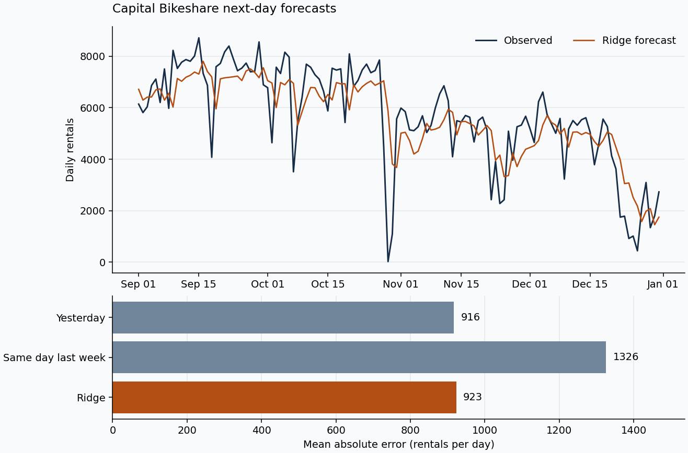

# Capital Bikeshare Next-Day Forecast

How much does a simple forecasting model improve daily rental estimates over repeating a recent count? This project compares Ridge regression with two baselines using 731 historical days of Washington, D.C., rental data.

[Read the executed notebook](bike_forecast.ipynb) · [Data provenance](data/README.md)



## Holdout results

The model fits on dates before September 2012. The 122-day holdout runs from September 1 through December 31, 2012.

| Forecast | MAE (rentals/day) | Mean bias (rentals/day) |
| --- | ---: | ---: |
| Yesterday's rentals | **916.4** | +37.9 |
| Same day last week | 1325.5 | +291.0 |
| Ridge regression | 922.9 | −102.5 |

For this holdout, the lowest overall error came from repeating yesterday's count. Ridge had a lower weekend MAE (1,037.9 vs 1,062.5) but higher weekday MAE (874.7 vs 855.2). Its largest miss came on October 29, when observed rentals fell to 22. These results support retaining the simpler baseline for this benchmark and evaluating any new model on newer data before operational use.

## Method

- Check for one valid rental count per consecutive calendar day.
- Use rentals from the previous day and week, a shifted seven-day mean, and weekend and annual calendar features.
- Fit the scaler and Ridge once on the training segment. Each one-day forecast can use the realized counts through the prior day. Tests check that changing today's or tomorrow's counts leaves today's features intact.
- Report mean absolute error (MAE) in rentals per day and bias as predicted minus actual. The citywide historical counts support an aggregate benchmark. Station-level planning would require station data and inventory.

## Run locally

Use Python 3.12. The daily input is included with attribution.

```sh
python -m pip install -r requirements-dev.txt
python bike_forecast.py --output reports
python -m pytest -q
```

The command writes date-level predictions, overall and weekday/weekend metrics, and the chart. Open the notebook with a Python 3 Jupyter kernel to rerun it.
